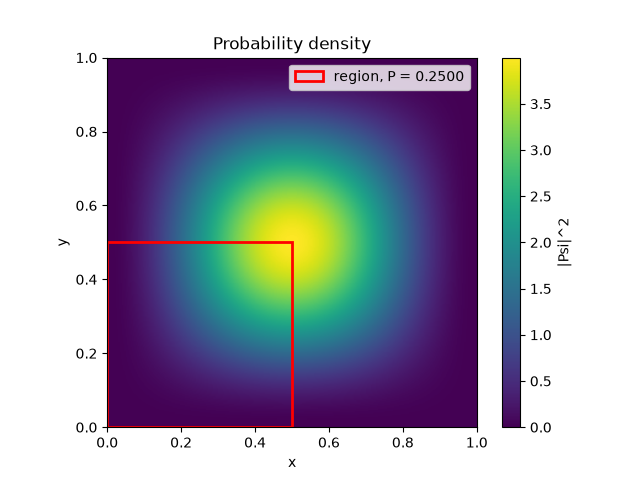
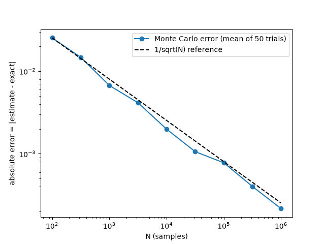

# Particle in a 2D Box: Monte Carlo Integration

Simulates a quantum particle in a two-dimensional box and uses the Monte Carlo method to compute the probability of finding the particle in a given region of the box, approximating the integral of the probability density over that region. The result is then checked against the exact answer.

## Problem

Consider a particle in a 2D box of length $`L_x`$ and breadth $`L_y`$. Its wave function is

```math
\Psi(x,y) = \sqrt{\frac{4}{L_x L_y}} \sin\left(\frac{n_x \pi x}{L_x}\right) \sin\left(\frac{n_y \pi y}{L_y}\right)
```

By the Born interpretation, the probability density is $`|\Psi(x,y)|^2`$, so the probability of finding the particle in $`x \in [x_1, x_2]`$, $`y \in [y_1, y_2]`$ is

```math
P = \int_{y_1}^{y_2}\int_{x_1}^{x_2} |\Psi(x,y)|^2 \, dx \, dy
```

## Method

### Monte Carlo estimator

Sample $`N`$ points uniformly in the region $`R = [x_1, x_2] \times [y_1, y_2]`$. Let $`f(x,y) = |\Psi(x,y)|^2`$ be the probability density. By definition, the average of $`f`$ over $`R`$ is

```math
\bar{f} = \frac{\iint_R f \, dx\,dy}{\iint_R dx\,dy} = \frac{P}{\text{Area}(R)}
```

so

```math
P = \text{Area}(R) \cdot \bar{f}
```

The sample mean of $`f`$ over the random points estimates this average. Its standard error is $`\sigma/\sqrt{N}`$, where $`\sigma`$ is the sample standard deviation of $`f`$ (computed with `ddof=1`). Scaling by the area gives the error on $`P`$:

```math
\text{error} = \frac{\text{Area}(R)\,\sigma}{\sqrt{N}}
```

### Independence and factorization

The normalization constant splits into one factor per axis:

```math
\sqrt{\frac{4}{L_x L_y}} = \sqrt{\frac{2}{L_x}} \cdot \sqrt{\frac{2}{L_y}}
```

so the wave function is a product of two 1D wave functions, $`\Psi(x,y) = \psi_{n_x}(x)\,\psi_{n_y}(y)`$, where

```math
\psi_n(t) = \sqrt{\frac{2}{L}} \, \sin\left(\frac{n\pi t}{L}\right)
```

and the density splits into a function of $`x`$ times a function of $`y`$:

```math
|\Psi(x,y)|^2 = |\psi_{n_x}(x)|^2 \cdot |\psi_{n_y}(y)|^2
```

If $`f`$ is the probability density function, this means

```math
f_{X,Y}(x,y) = f_X(x) \cdot f_Y(y) \quad \text{for all } x, y
```

so $`X`$ and $`Y`$ are independent, and the joint density is the product of the marginal densities. It follows that

```math
P(x_1 \le X \le x_2,\ y_1 \le Y \le y_2) = P(x_1 \le X \le x_2) \cdot P(y_1 \le Y \le y_2)
```

This property is verified numerically using two separate 1D Monte Carlo integrals, $`P_x = (x_2 - x_1)\,\bar{f}_X`$ and likewise for $`P_y`$, whose product is compared with the 2D estimate.

### Exact result

Using $`\sin^2\theta = \frac{1 - \cos 2\theta}{2}`$, for each axis:

```math
\int_0^a \frac{2}{L}\sin^2\left(\frac{n\pi t}{L}\right) dt = \frac{a}{L} - \frac{\sin(2n\pi a/L)}{2n\pi}
```

For a general interval, call this antiderivative $`F(t)`$ and take $`F(b) - F(a)`$. The exact 2D probability is the product of the x and y parts, by the independence above.

## Results

Parameters: $`n_x = 1`$, $`n_y = 1`$, $`L_x = L_y = 1`$, region $`[0, L_x/2] \times [0, L_y/2]`$, $`N = 10^6`$, seed 42.

| Method | P |
|---|---|
| Exact | 0.250000 |
| Monte Carlo (2D) | 0.249875 ± 0.000279 |
| Monte Carlo ($`P_x \cdot P_y`$) | 0.250132 |

For this half-box region the exact answer is 1/4 for any energy levels, since $`\sin(n\pi) = 0`$.

### Probability density



*The integration region is outlined in red. The number of bright lobes along each axis is equal to the energy level.*

### Convergence



*Mean absolute error over 50 trials per sample size. The error falls as $`1/\sqrt{N}`$*

## How to run

```bash
pip install -r requirements.txt
python particle_in_box.py
```
